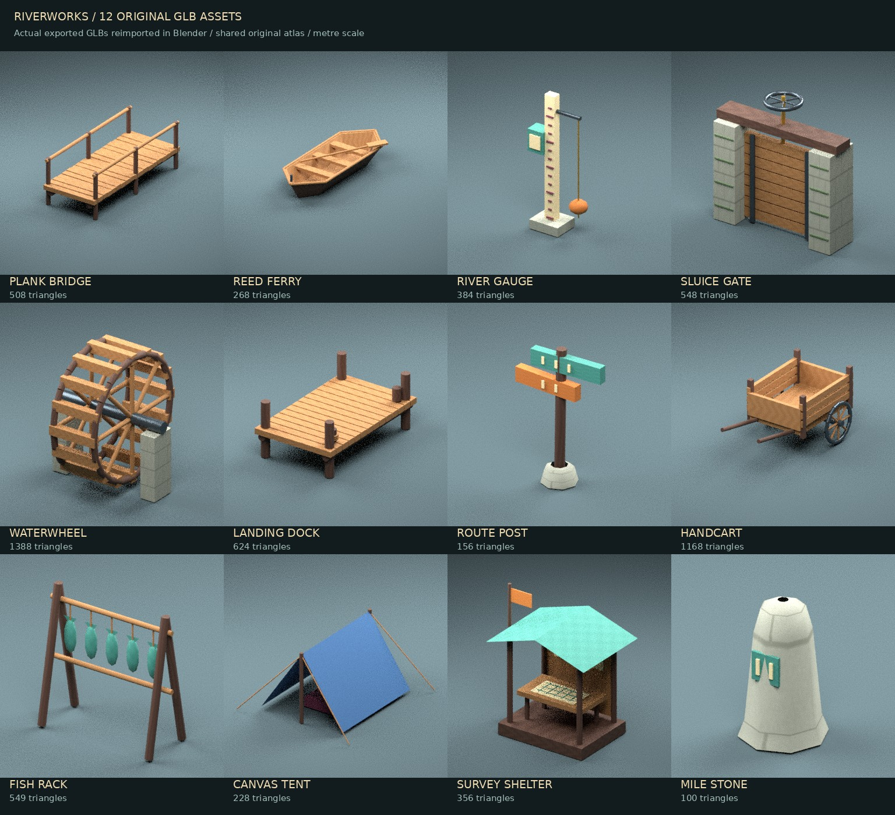

# 川仕事のGLB追加素材

既存の `feat/fairytale-warps` の54モデルに、独自制作の12モデルを追加。外部のモデル・テクスチャは使用していません。既存の自作アトラスとOpenGL ES 2.0用デコーダーを使います。



| ファイル | 名称 | 三角形数 | 寸法 X × Y × Z (m / Blender Z-up) |
|---|---|---:|---|
| `plank_bridge.glb` | 継ぎ板橋 | 508 | 1.71 × 4.07 × 1.40 |
| `reed_ferry.glb` | 葦洲の渡し舟 | 268 | 1.61 × 3.95 × 0.80 |
| `river_gauge.glb` | 水位記録柱 | 384 | 1.34 × 0.60 × 3.00 |
| `sluice_gate.glb` | 手回し水門 | 548 | 3.10 × 0.87 × 3.15 |
| `waterwheel.glb` | 川仕事の水車 | 1388 | 2.20 × 2.43 × 2.58 |
| `landing_dock.glb` | 係留桟橋 | 624 | 1.90 × 3.05 × 1.25 |
| `route_post.glb` | 川道の道標 | 156 | 1.51 × 0.56 × 2.15 |
| `handcart.glb` | 二輪の荷車 | 1168 | 1.90 × 3.03 × 1.40 |
| `fish_rack.glb` | 渡守の魚干し台 | 549 | 1.80 × 0.81 × 1.82 |
| `canvas_tent.glb` | 測量隊の天幕 | 228 | 2.62 × 2.82 × 1.48 |
| `survey_shelter.glb` | 川筋測量所 | 356 | 2.94 × 2.20 × 3.50 |
| `mile_stone.glb` | 二番川標 | 100 | 0.80 × 0.80 × 1.29 |

追加分は6,277三角形・合計2,172,340バイト。GLBはそれぞれテクスチャを内包するため、単体でも読み込めます。ゲームは従来通り共通アトラスを使用します。glTF出力はY-up、単位はメートル、部品のスキニング・アニメーションはありません。

## 今回の実装範囲

測量小屋・道標・荷車・天幕・道程標・魚干し台の6種は `SceneCatalog` に景観として配置。残りの橋・舟・水位計・水門・水車・桟橋もGLBとマニフェストに登録され、ゲーム起動時に読み込まれます。橋の通行判定、舟の操縦、修理、水門操作は未実装です。地域名・用語・地域配置と目的提示の作り直しは次の工程です。

## 編集と再生成

`art/river_assets.py` が追加分の形状定義。`art/fablewind-assets.blend` に既存54種と追加12種の編集可能なメッシュ・マテリアル・内包アトラスを保存しています。

```sh
blender -b -t 2 --python art/create_assets.py -- --river-only
blender -b -t 2 --python art/preview_river_assets.py
python art/contact_sheet.py
sh scripts/check-world.sh
```

`--river-only` は既存54種のGLBを再出力せず、12種と全モデルのBlender原本・マニフェストを更新します。全66種を再生成する場合はオプションを省略します。プレビュー作成にはPillowとDejaVu Sansフォントが必要です。

## 検証

- 全66種類を実際のJavaデコーダーで読み込み、法線・UV・有限値・マニフェストの三角形数とファイルサイズ・登録漏れを検証。
- 既存のワープ、採取、製作、建築、戦闘、セーブ復元などのテストが成功。
- 追加12種は書き出したGLBをBlenderへ読み戻し、上の一覧画像で目視確認。
- Androidの描画テストはモデル数をマニフェストから取得するよう更新。この作業環境ではAndroid SDK・Gradleがないため、APKビルドとEGL上での追加素材確認は未実行。
